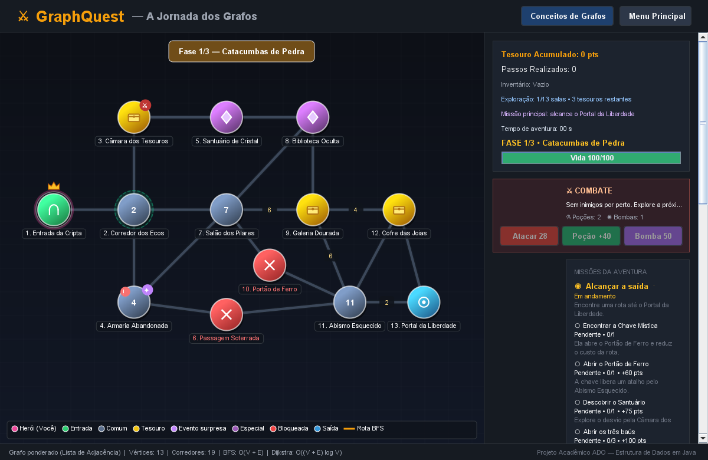
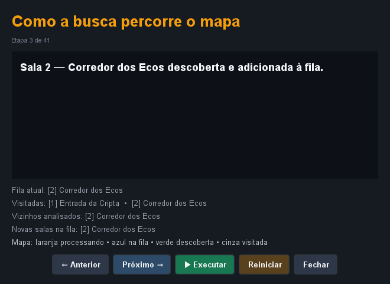
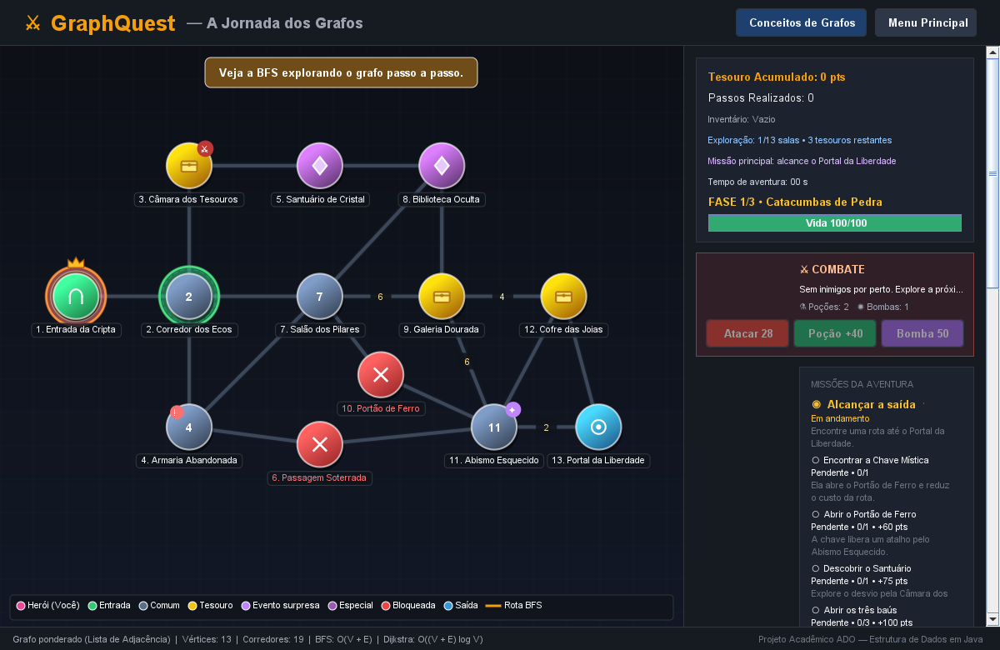
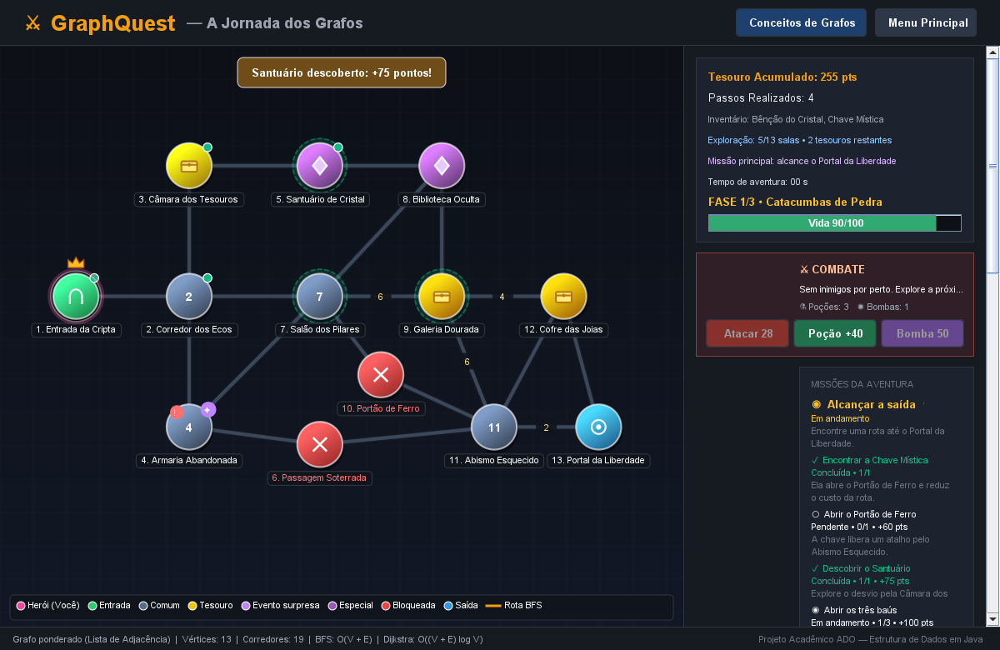
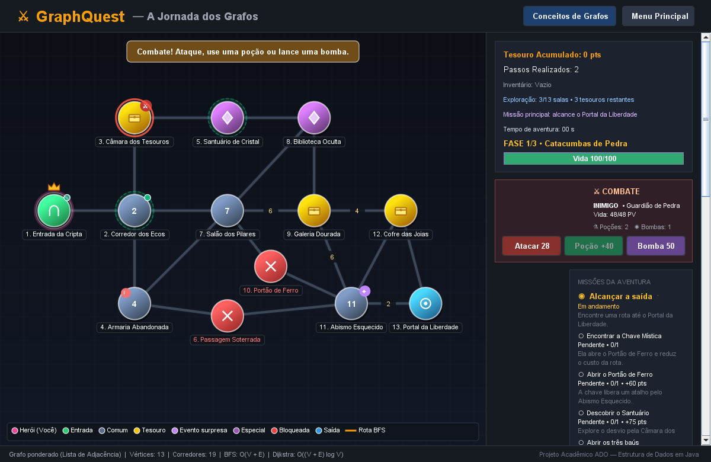

# GraphQuest — A Jornada dos Grafos

[](https://adoptium.net/)
[]()
[-green.svg)]()
[]()
[]()

> **Atividade Prática Acadêmica (ADO) de Estrutura de Dados em Java**  
> Um jogo desktop de exploração de masmorra em que o mapa é um grafo real. A **BFS** encontra a rota com menos passagens e **Dijkstra** encontra a rota de menor custo.

---

## 1. OBJETIVO DO PROJETO

O objetivo principal do **GraphQuest** é demonstrar como uma estrutura de dados não-linear fundamental (o **Grafo**) e um algoritmo clássico de busca (**BFS**) resolvem um problema concreto e visual de navegação em uma masmorra medieval:

- Cada **câmara ou sala** é modelada como um **Vértice ($V$)**.
- Cada **passagem ou corredor** é modelado como uma **Aresta ($E$)**.
- O jogador controla um aventureiro que deve explorar o ambiente, recolher tesouros, desviar de desmoronamentos intransitáveis, encontrar a chave para abrir portões e alcançar o Portal de Saída.
- A qualquer momento, o jogador pode acionar o algoritmo de **Busca em Largura (BFS)** para calcular e visualizar no mapa o trajeto com o menor número de arestas até a saída.
- Também pode executar **Dijkstra** para comparar a rota de menor custo, considerando pesos diferentes nos corredores.
- A demonstração interativa registra os eventos da execução real da BFS e permite avançar e voltar por eles.

### Melhorias de jogabilidade e interface

- O mapa se ajusta ao tamanho da janela, e o aventureiro anima o deslocamento entre salas.
- Mensagens visuais destacam tesouros, itens, bloqueios e a vitória.
- O placar acompanha as salas exploradas, os tesouros restantes e o objetivo atual.
- Cinco missões reais acompanham a saída, a Chave Mística, o portão, o Santuário e os três baús; objetivos opcionais pagam recompensas únicas.
- O Santuário concede +75 pontos, abrir o portão concede +60 e abrir todos os baús concede +100; a chave continua opcional para alcançar a saída.
- Teclas WASD/setas movimentam o jogador por vizinhos reais do grafo; B calcula a rota BFS.
- Um cristal secreto aparece em uma sala aleatória entre as salas 4, 7 e 11; coletá-lo concede 50 pontos extras. A posição muda ao reiniciar a partida.
- Ao escapar, o resumo registra tempo, pontuação, movimentos, percentual explorado, tesouros, missões e classificação transparente, com ações para jogar novamente ou voltar ao menu.
- A campanha tem oito fases temáticas, com mapas procedurais crescentes de 13 a 34 salas, geradas como grafos conectados; chefes aparecem nas fases 4 e 8.
- O perfil persistente local guarda moedas, compras, equipamentos, melhorias, consumíveis e resultados. A loja oferece aprimoramentos com efeitos reais no combate e na preparação.
- Guardiões podem proteger câmaras de recompensa. Combate por turnos: ataque, poção e bomba; tesouros são liberados após vencer. Até dois recuos por campanha evitam becos sem saída; após isso, a expedição pode terminar em derrota.
- Armadilhas e segredos são sinalizados no mapa; relíquias e portais recebem brilho animado. Cada bioma tem paleta própria e a escala do mapa se ajusta ao tamanho da fase.
- O resumo final apresenta a recompensa econômica, o saldo, exploração, tesouros e missões. A campanha paga moedas uma única vez por identificador.

---

## 2. REQUISITOS DO SISTEMA

- **Java Development Kit (JDK):** Versão 17 ou superior (testado e certificado no OpenJDK 21 LTS).
- **Sistema Operacional:** Windows, Linux ou macOS.
- **Ambiente de Desenvolvimento:** IntelliJ IDEA, Eclipse, VS Code ou terminal puro (sem dependência obrigatória de IDE).
- **Maven:** Opcional. O projeto possui `pom.xml` padrão, mas também inclui scripts `.bat` para compilação e execução imediata sem ferramentas externas.

---

## 3. COMO EXECUTAR NO WINDOWS (FORMA MAIS RÁPIDA)

O projeto inclui scripts em lote prontos para execução em um clique no Windows:

1. **Para Compilar:**  
   Dê um duplo clique no arquivo `compilar.bat` (ou execute via terminal: `.\compilar.bat`).
2. **Para Iniciar o Jogo:**  
   Dê um duplo clique no arquivo `executar.bat` (ou execute via terminal: `.\executar.bat`).
3. **Para Rodar os Testes Automatizados:**  
   Dê um duplo clique no arquivo `testar.bat` (ou execute via terminal: `.\testar.bat`).

---

## 4. COMO ABRIR E EXECUTAR NO INTELLIJ IDEA

1. Abra o IntelliJ IDEA.
2. Selecione **File ➜ Open...** (ou na tela inicial, clique em **Open**).
3. Navegue até a pasta descompactada `GraphQuest` e selecione o arquivo `pom.xml` (ou a pasta raiz).
4. Escolha **Open as Project**.
5. O IntelliJ importará o projeto automaticamente como projeto Maven.
6. Certifique-se de que o **Project SDK** está configurado para Java 17 ou superior (**File ➜ Project Structure ➜ Project**).
7. Para iniciar o jogo:
   - Abra a classe `src/main/java/br/com/graphquest/Main.java`.
   - Clique no ícone verde de **Play** ao lado do método `main(String[] args)`.
8. Para rodar os testes:
   - Abra a classe `src/main/java/br/com/graphquest/testes/TestesGrafo.java` ou `src/test/java/br/com/graphquest/grafo/GrafoTest.java` e clique em **Run**.

---

## 5. COMO JOGAR

### 5.1. Controles
- **Movimentação pelo Mapa:** Clique com o botão esquerdo do mouse em qualquer sala conectada à sua sala atual.
- **Movimentação pelo Painel Lateral:** Clique nos botões da seção *"Salas Conectadas"*; cada opção exibe o custo da passagem.
- **Teclado:** WASD ou setas seguem o vizinho conectado mais alinhado naquela direção; pressione **B** para calcular a rota BFS.
- **Salas Acessíveis:** As salas vizinhas navegáveis pulsam com um halo verde esmeralda no mapa.

### 5.2. Tipos de Salas e Mecânicas
- **Entrada da Cripta (Sala 1 - Verde):** Sala de início da aventura.
- **Salas Comuns (Azul Acinzentado):** Corredores de transição.
- **Salas de Tesouro (Dourado):** Contêm baús com pontos (+100, +200, +300 pts) que só podem ser recolhidos uma única vez.
- **Salas Especiais (Roxo):** Explorar o Santuário (Sala 5) conclui uma missão e paga +75 pontos; a Biblioteca Oculta concede a *Chave Mística*.
- **Passagem Soterrada (Sala 6 - Vermelho):** Obstáculo permanente (desmoronamento de rochas intransitável). Obriga a contornar por outra rota!
- **Portão de Ferro (Sala 10 - Vermelho):** A chave o abre ao entrar; conclua a missão para receber +60 pontos. Ele libera um desvio, mas não é obrigatório para chegar à saída.
- **Missão dos baús:** abrir os três tesouros da masmorra concede +100 pontos extras, uma única vez.
- **Classificação final:** Mestre exige 15 salas exploradas e pelo menos dois terços dos baús; Aventureiro exige 10 salas e um objetivo opcional; os demais resultados recebem Explorador.
- **Portal da Liberdade (Sala 13 - Azul Claro):** Avança para a próxima fase; na terceira, é necessário derrotar o Dragão das Sombras.
- **Combate e recursos:** Ataque, poção e bomba são ações disponíveis no card lateral. Guardiões revidam por turno e a câmara só libera tesouros após a vitória.
- **Armadilhas:** O marcador vermelho `!` alerta sobre uma sala perigosa; cada armadilha causa dano uma vez na fase.

### 5.3. Comparando rotas
- Clique em **"BFS • Menos passagens"** para destacar em dourado o caminho com menos corredores.
- Clique em **"Dijkstra • Menor custo"** para destacar em azul o caminho com menor soma de pesos.
- Clique em **"Explicar Teoria BFS"** para ler o passo a passo acadêmico completo com a distância em arestas e a complexidade temporal e espacial.
- Clique em **"Demonstrar BFS passo a passo"** para acompanhar fila, salas processadas, vizinhos analisados e reconstrução do caminho; use anterior, próximo, executar, pausar ou reiniciar.
- Os números sobre alguns corredores representam seus custos; os corredores sem número custam 1. A lista de salas conectadas também mostra o custo de cada movimento.

---

## 6. IMPLEMENTAÇÃO DA ESTRUTURA DE DADOS GRAFO

A classe `br.com.graphquest.grafo.Grafo` implementa um **Grafo Não-Direcionado e Ponderado** usando **Lista de Adjacência** e pesos por aresta:

```java
private final Map<Sala, List<Sala>> listaAdjacencia;
private final Map<Sala, Map<Sala, Integer>> pesosArestas;
```

### Operações Fundamentais Implementadas:
- `adicionarVertice(Sala sala)`: Insere uma nova sala no grafo.
- `adicionarAresta(Sala u, Sala v, int peso)`: Estabelece conexão bidirecional com custo positivo.
- `obterVizinhos(Sala sala)`: Retorna a lista de salas diretamente adjacentes.
- `saoVizinhos(Sala u, Sala v)`: Verifica a conexão em $O(grau(u))$, pois a lista de vizinhos é percorrida.
- `buscarMenorCaminho(Sala origem, Sala destino)`: Executa BFS e minimiza o número de arestas.
- `buscarMenorCusto(Sala origem, Sala destino, Set<String> inventario)`: Executa Dijkstra e minimiza a soma dos pesos.

---

## 7. O ALGORITMO BFS (BUSCA EM LARGURA)

A BFS foi desenvolvida estritamente com recursos nativos do Java:

1. **Fila FIFO:**
   ```java
   Queue<Sala> fila = new ArrayDeque<>();
   ```
   Garante a exploração por níveis de profundidade (arestas = 1, arestas = 2, etc.).
2. **Conjunto de Visitados:**
   ```java
   Set<Sala> visitados = new LinkedHashSet<>();
   ```
   Impede loops infinitos decorrentes de ciclos no grafo.
3. **Mapa de Predecessores:**
   ```java
   Map<Sala, Sala> predecessores = new HashMap<>();
   ```
   Registra a sala de origem de cada passo para reconstruir o menor caminho.
4. **Respeito aos Obstáculos:**
   Salas permanentemente bloqueadas são desconsideradas. Uma sala trancada que exige item é transitável para a busca quando o inventário contém a chave.

### BFS, Dijkstra e complexidade assintótica

BFS minimiza a quantidade de arestas. Dijkstra considera os pesos positivos e minimiza o custo total. As passagens não numeradas custam 1; os trechos perigosos 7–9 e 9–11 custam 6, a rota até o Cofre 9–12 custa 4 e o atalho 11–13 custa 2. A chave libera o Portão 10 e uma rota de menor custo; sem a chave, a saída segue acessível por caminhos alternativos. A passagem soterrada permanece bloqueada.

- **Tempo:** $O(V + E)$ — Cada vértice entra na fila uma vez e cada aresta é percorrida duas vezes.
- **Espaço Auxiliar:** $O(V)$ — Armazenamento na fila, conjunto de visitados e mapa de predecessores.
- **Dijkstra:** $O((V + E) \log V)$ com fila de prioridade; espaço auxiliar $O(V)$.

---

## 8. BATERIA DE TESTES AUTOMATIZADOS

O projeto conta com uma suíte standalone de **27 testes automatizados**, executável sem Maven:

1. **Caminho simples:** Valida travessia direta entre salas conectadas.
2. **Menor caminho entre alternativas:** Garante que a BFS escolhe a rota com menos arestas quando existem múltiplos caminhos.
3. **Destino inalcançável:** Testa comportamento em nós desconectados.
4. **Origem igual ao destino:** Valida o caso trivial de distância zero.
5. **Salas bloqueadas:** Garante a exclusão estrita de desmoronamentos na rota.
6. **Ausência de loops infinitos:** Garante término correto em grafos com ciclos.
7. **Reinício da partida:** Valida restauração completa dos estados do grafo e do jogo.
8. **Mecânica de tesouros:** Valida coleta única e contagem de pontuação.
9. **Rastro da BFS:** Confere que a demonstração termina com a rota calculada.
10. **Movimento inválido:** Confere que posição, passos e pontuação permanecem intactos.
11. **Chave e reinício:** Confere o portão, a chave e a restauração da masmorra.
12. **Vitória:** Confere o encerramento ao alcançar o portal.
13. **Identidade dos vértices:** Rejeita salas externas com ID repetido.
14. **Dijkstra ponderado:** Confere que Dijkstra minimiza o custo.
15. **Evento bônus:** Confere o prêmio de 50 pontos e coleta única.
16. **Vértices inválidos:** Confere rejeição de origem/destino nulos e grafo vazio.
17. **Arestas duplicadas:** Confere que uma ligação repetida não duplica vizinhos.
18. **Bloqueio permanente:** Confere que uma chave não abre desmoronamento.
19. **Missões opcionais:** Confere recompensa do Santuário e do portão, sem pagamento repetido.
20. **Missão de tesouros:** Confere a conclusão ao abrir os três baús e o bônus único.
21. **Resumo de vitória:** Confere tempo congelado, exploração, movimentos e classificação.
22. **Movimento direcional:** Confere que teclas selecionam apenas vizinhos reais.
23. **Saída sem chave:** Confere que a rota alternativa mantém a aventura concluível.
24. **Resumo da campanha:** Confere exploração acumulada e classificação ao concluir as oito fases.
25. **Progressão:** Confere a passagem da primeira para a segunda fase.
26. **Combate e consumíveis:** Confere restrição de movimento durante o encontro e uso da bomba.
27. **Armadilha:** Confere dano e acionamento único por fase.

Para executar:
```bash
.\testar.bat
```
Última execução standalone: **27 de 27 aprovados (100% de sucesso)**. Também há testes JUnit 5; `testar.bat` executa `mvn test` quando Maven está instalado. Neste ambiente Maven não estava disponível, então os testes JUnit não foram executados.

## 9. CAPTURAS DE TELA











---

## 10. ESTRUTURA DOS ARQUIVOS DE ENTREGA

```
GraphQuest/
├── pom.xml                                  # Arquivo de configuração Maven
├── README.md                                # Documentação completa do projeto
├── compilar.bat                             # Script de compilação rápida no Windows
├── executar.bat                             # Script de execução rápida no Windows
├── testar.bat                               # Script de testes automatizados no Windows
├── apresentacao/
│   └── GraphQuest_ADO.pptx                  # Apresentação PowerPoint (10 slides)
├── docs/
│   ├── ARQUITETURA_E_GRAFOS.md              # Documentação técnica e teoria de grafos
│   ├── ROTEIRO_APRESENTACAO.md              # Roteiro de fala slide a slide e FAQ
│   └── screenshots/                         # Capturas de tela reais da aplicação
│       ├── screenshot_01_menu_inicial.png
│       ├── screenshot_02_mapa_inicial.png
│       ├── screenshot_03_mapa_bfs_rota.png
│       ├── screenshot_04_dialogo_conceitos.png
│       ├── screenshot_05_bfs_detalhes.png
│       ├── screenshot_06_comparacao_rotas.png
│       ├── screenshot_07_bfs_execucao.png
│       ├── screenshot_08_bfs_controles.png
│       ├── screenshot_09_missoes_e_progresso.png
│       └── screenshot_10_combate.png
└── src/
    ├── main/java/br/com/graphquest/
    │   ├── Main.java                        # Ponto de entrada (Swing EDT)
    │   ├── modelo/
    │   │   ├── Sala.java                    # Vértice do Grafo
    │   │   └── TipoSala.java                # Enumeração de categorias de sala
    │   ├── grafo/
    │   │   ├── Grafo.java                   # Lista de adjacência, BFS e Dijkstra
    │   │   ├── PassoBFS.java                # Eventos compactos da execução da BFS
    │   │   ├── EstadoBFS.java               # Estado derivado dos eventos até uma etapa
    │   │   ├── ResultadoBFS.java            # Resultado e métricas da BFS
    │   │   └── ResultadoDijkstra.java       # Resultado e métricas de Dijkstra
    │   ├── jogo/
    │   │   ├── Jogo.java                    # Regras, fases, combate, consumíveis, missões e pontuação
    │   │   ├── Inimigo.java                 # Estado dos guardiões e do chefe
    │   │   ├── Missao.java                  # Progresso e estado dos objetivos
    │   │   ├── ResumoAventura.java          # Estatísticas finais imutáveis
    │   │   ├── JogoListener.java            # Interface Observer para a UI
    │   │   └── MasmorraPadrao.java          # Configuração dos nós e arestas
    │   ├── ui/
    │   │   ├── TemaVisual.java              # Cores, botões e tipografia
    │   │   ├── PainelMapa.java              # Renderizador Java2D do grafo
    │   │   ├── PainelInformacoes.java       # Painel lateral e comparação de rotas
    │   │   ├── DialogoConceitos.java        # Modal com conceitos teóricos
    │   │   ├── DialogoDemonstracaoBFS.java  # Controles da demonstração passo a passo
    │   │   ├── DialogoComoJogar.java        # Modal de instruções
    │   │   ├── TelaInicial.java             # Menu principal
    │   │   └── TelaPrincipal.java           # Janela principal do jogo
    │   ├── testes/
    │   │   └── TestesGrafo.java             # Bateria de testes standalone
    │   └── util/
    │       ├── CapturaTelas.java            # Gerador de screenshots
    │       └── GeradorApresentacaoPPTX.java # Gerador nativo do GraphQuest_ADO.pptx
    └── test/java/br/com/graphquest/
        ├── grafo/GrafoTest.java             # Testes unitários JUnit 5 para o grafo
        └── jogo/JogoTest.java               # Testes JUnit 5 das regras de jogo
```

---

## 11. CONSIDERAÇÕES FINAIS

O projeto **GraphQuest** atende com rigor técnico a todos os requisitos do enunciado:
- A estrutura de dados Grafo é real, implementada em Java sem bibliotecas prontas.
- BFS minimiza a quantidade de passagens; Dijkstra minimiza o custo usando pesos e fila de prioridade.
- A demonstração passo a passo percorre eventos gerados pelo mesmo BFS que calcula a rota; a interface deriva a fila e os conjuntos reproduzindo esses eventos.
- O mapa gráfico é 100% coerente com as conexões do grafo.
- A apresentação `.pptx` de 10 slides está gerada e disponível em `apresentacao/GraphQuest_ADO.pptx`.
- A documentação e o roteiro para apresentação em sala de aula estão completos.
